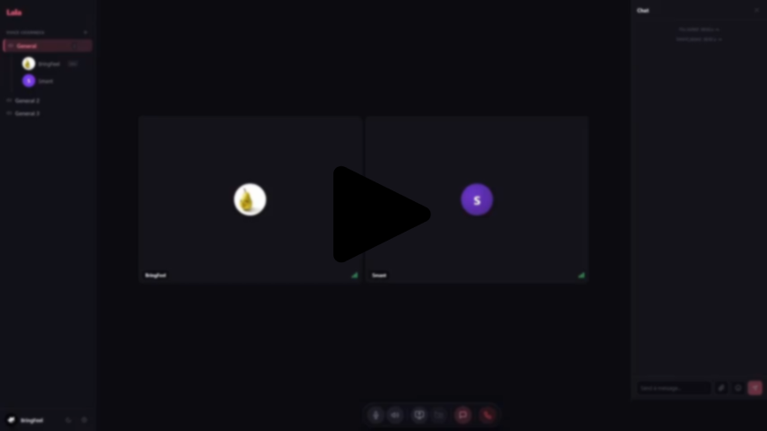

# Lala Music Bot

<div align="center">Idiomas / Languages</div>
<div align="center">
  <a href="README.md">ES 🇪🇸</a>
  |
  <a href="#lala-music-bot">EN 🇺🇸</a>
</div>

---

A music bot for [Lala](https://github.com/eeegoloauq/lala). It connects to a voice channel, streams audio through LiveKit, and allows playback to be controlled through chat.

[](./github_media/demo.mp4)

> [!IMPORTANT]
> This bot was developed entirely using Artificial Intelligence (AI).

## Features

- Plays links and search results using `yt-dlp`.
- Supports playlists and a playback queue.
- Accepts commands through Lala chat or the console.
- Automatically connects when participants are present and disconnects after 30 seconds of inactivity.
- Supports password-protected servers and channels, including E2EE.
- Messages available in Spanish and English.
- Persistent statistics for queued songs and time spent in calls.
- Optional profile picture.
- Automatic reconnection after temporary errors.
- Local or Docker deployment.

## Requirements

### Local execution

- Node.js 20 or later (Node.js 22 recommended).
- `ffmpeg` available in `PATH` or configured through `FFMPEG_PATH`.
- Python 3.11 or later on Linux/macOS.
- Network access to the Lala server and LiveKit.
- GitHub access during dependency installation to download `yt-dlp`.

On Windows, `youtube-dl-exec` uses `yt-dlp.exe`, which includes Python.

### Docker

- Docker Engine and Docker Compose.
- Access to npm and GitHub when building the image.

## Local installation

From the project directory:

```bash
npm install
```

Create the `.env` file:

```bash
cp .env.example .env
```

On PowerShell:

```powershell
Copy-Item .env.example .env
```

Complete the configuration and start the bot:

```bash
npm start
```

To stop the process, press `Ctrl+C`.

## Configuration

Configuration is defined in `music-bot/.env`. Changes require restarting the bot.

| Variable | Required | Default | Description |
| --- | --- | --- | --- |
| `SERVER_URL` | Yes | — | Lala base URL, including the protocol and without `/api`. Example: `https://lala.example.com`. |
| `CHANNEL_NAME` | Yes | — | Name of the voice channel the bot should join. |
| `SERVER_PASSWORD` | No | Empty | Lala server password, if applicable. |
| `CHANNEL_PASSWORD` | No | Empty | Channel password. Required for password-protected channels; also used to derive E2EE keys. |
| `BOT_NAME` | No | `Lala Music Bot` | Display name of the bot. |
| `LANGUAGE` | No | `es` | Message language: `es` or `en`. Values starting with `en` select English; all others select Spanish. |
| `COMMAND_PREFIX` | No | `!` | Command prefix. |
| `FFMPEG_PATH` | No | `ffmpeg` | FFmpeg executable command or path. |
| `AVATAR_PATH` | No | Empty | Image filename inside `avatar/`. Example: `avatar.jpg`. |
| `STATE_DIR` | No | Project directory | Directory for `.device-id` and `stats.json`. Set to `/data` in Docker. |

Example:

```env
SERVER_URL=https://lala.example.com
SERVER_PASSWORD=
CHANNEL_NAME=General
BOT_NAME=Lala Music Bot
LANGUAGE=es
COMMAND_PREFIX=!
CHANNEL_PASSWORD=
FFMPEG_PATH=ffmpeg
AVATAR_PATH=avatar.jpg
STATE_DIR=
```

`SERVER_PASSWORD` and `CHANNEL_PASSWORD` can be left empty if they are not used. `SERVER_URL` may end with `/`; the bot removes it automatically. If `STATE_DIR` is not set, state files are stored in the project directory.

The `.device-id` file identifies the bot to Lala. It should be preserved across restarts, especially in Docker deployments. `stats.json` is updated when songs are queued and when a call ends.

## Commands

Commands are available in the channel chat and in the console. The configured prefix is required in chat but optional in the console.

| Command | Alias | Description |
| --- | --- | --- |
| `!play <link or search>` | `!p` | Adds a song or playlist to the queue. Text searches use the first result returned by `yt-dlp`. |
| `!skip` | `!s` | Skips the current song or cancels its download. |
| `!clear` | `!c` | Clears the pending queue without stopping the currently playing song. |
| `!stats` | — | Displays uptime, queued songs, and accumulated time in calls. |
| `!help` | — | Displays the available commands. |

Examples:

```text
!play https://www.youtube.com/watch?v=jNQXAC9IVRw
!play never gonna give you up
!skip
!clear
!stats
!help
```

Commands are case-insensitive. Any participant can run them; role-based permissions are not currently available. Messages that do not start with the configured prefix are ignored.

Responses are sent to the chat and also displayed in the console. If playback fails, the chat receives a generic error message while the details are logged to the console.

## Translations

All messages are centralized in `src/i18n/`. The available languages are Spanish (`es.js`) and English (`en.js`), selected through `LANGUAGE`.

Dynamic messages use placeholders, such as `{song_count}`. To add another language, create a dictionary with the same keys and register it in `src/i18n/index.js`.

## Statistics

The `stats` command displays:

- Process uptime.
- Number of songs added to the queue.
- Accumulated time spent in calls.

Persistent data is stored in `stats.json` inside `STATE_DIR`:

```json
{
  "songsPlayed": 42,
  "callTimeMs": 11707000
}
```

`songsPlayed` counts queued songs, even if their download or playback fails. Uptime is calculated from the last process start and is not preserved across restarts. The duration of an active call is included in the command output and saved when the bot disconnects.

If the file does not exist or cannot be read, statistics start at zero. Write errors are logged to the console and do not stop the bot.

## Profile picture

To configure an image, place it in `avatar/` and set its filename in `.env`:

```text
music-bot/
└── avatar/
    └── avatar.jpg
```

```env
AVATAR_PATH=avatar.jpg
```

At startup, the bot processes the image: it crops and resizes it to 128 × 128, converts it to JPEG, and publishes it as the `lala.avatar` attribute. The final image must comply with Lala's 32 KB size limit. Any format supported by FFmpeg can be used.

The image is loaded at startup, so the bot must be restarted for changes to take effect. If the image cannot be processed, the bot continues without a profile picture. Displaying it depends on whether the Lala client supports the `lala.avatar` attribute.

## Docker

Create and complete `music-bot/.env`. From the project directory, build and start the service:

```bash
docker compose up -d --build
```

View logs:

```bash
docker compose logs -f music-bot
```

Stop the service:

```bash
docker compose down
```

The Compose configuration uses the `music_bot_data` volume mounted at `/data` to preserve `.device-id` and `stats.json`. It also mounts `./avatar` at `/app/avatar` as read-only. The container runs as a non-root user, has a 1 GB memory limit, and uses `restart: unless-stopped`.

To also remove persistent data:

```bash
docker compose down -v
```

> **Important:** Removing the volume generates a new bot identity and resets the statistics.

### Docker connectivity

Inside the container, `localhost` refers to the container itself. If Lala runs on the host, use its public URL or, on Docker Desktop, an address such as:

```env
SERVER_URL=http://host.docker.internal:3001
```

The bot requires outbound network access to the Lala API and LiveKit. Ports depend on the server configuration; a typical setup may use TCP 7880/7881 and UDP 50000/3478.

## Project structure

```text
music-bot/
├── src/
│   ├── index.js        # Startup, connection, and reconnection
│   ├── config.js       # Configuration and device state
│   ├── lala.js         # Lala API and authentication
│   ├── player.js       # Queue and audio playback
│   ├── ytdlp.js        # Audio resolution and downloading
│   ├── commands.js     # Command processing
│   ├── stats.js        # Persistent statistics
│   ├── avatar.js       # Profile picture processing
│   └── i18n/           # Translations
│       ├── index.js
│       ├── es.js
│       └── en.js
├── avatar/             # Profile pictures
├── .env.example        # Configuration template
├── Dockerfile
├── docker-compose.yml
├── package.json
├── package-lock.json
├── README.md
└── README.en.md
```

Files generated at runtime:

- `.device-id`: persistent device identity.
- `stats.json`: playback and call statistics.
- Temporary audio files: removed when playback finishes or is canceled.

## How it works

### Connection

At startup, the bot loads the configuration, retrieves or generates `.device-id`, and loads the statistics. If the server requires a password, it authenticates through `POST /api/access`. It then queries `GET /api/rooms` to locate `CHANNEL_NAME` and requests a LiveKit token through `POST /api/token`.

Requests include the device identifier in `X-Lala-Device`.

### Password-protected channels

When a channel is password-protected, the bot derives authentication and E2EE keys from `CHANNEL_PASSWORD` using PBKDF2-SHA256 and HKDF. The authentication key is sent when requesting the token, while the E2EE key is used for the LiveKit connection.

### Waiting and disconnecting

The bot checks the channel every five seconds. If the channel does not exist, is unavailable, or is empty, it keeps waiting. It connects when it finds at least one participant other than itself.

If the channel becomes empty, the bot waits 30 seconds before disconnecting. If someone joins during that interval, the disconnect is canceled. The bot then returns to the waiting cycle.

### Playback

`yt-dlp` resolves links and searches, then downloads the audio. FFmpeg converts it to 48 kHz, 16-bit mono PCM. The bot sends the audio to LiveKit in 20 ms frames.

When a song finishes, fails, or is canceled, its temporary file is removed and the next item in the queue is processed.

### Shutdown

On `SIGINT` or `SIGTERM`, the bot stops accepting commands, stops playback, saves the statistics, disconnects from LiveKit, and releases audio resources.

## Errors and reconnection

**Errors that require configuration changes or intervention:**

- `password_required`: `CHANNEL_PASSWORD` is missing.
- `wrong_password`: the server or channel password is incorrect.
- `not_allowed`: the bot is not allowed to join.
- `banned`: the bot is blocked.
- `PARTICIPANT_REMOVED`: the bot was removed from the channel.
- `DUPLICATE_IDENTITY`: another instance is using the same identity.

**Temporary errors:**

Server availability issues, missing or full channels, and non-fatal connection failures are retried without terminating the process.

**Playback errors:**

If audio resolution, downloading, or conversion fails, the bot sends a generic error message in chat, logs the details to the console, discards the song, and continues with the queue.

Avatar and statistics persistence errors are logged to the console but do not stop the service.

## Limitations

- Each instance manages a single channel (`CHANNEL_NAME`).
- The same `.device-id` cannot be shared between active instances.
- The queue is stored in memory and is lost when the process restarts.
- Pause, resume, volume, and seek controls are not available.
- `clear` does not stop the currently playing song.
- Any participant can run commands.
- `songsPlayed` counts queued songs, not completed playbacks.
- Persistence requires `STATE_DIR` to be writable and, in Docker, the volume to be preserved.
- Configuration and profile picture changes require restarting the bot.
- YouTube playback depends on `yt-dlp`; dependency updates may be required if the service changes.

## Troubleshooting

| Issue | What to check |
| --- | --- |
| `SERVER_URL` is missing | Create `.env` from `.env.example` and fill in the required variables. |
| The bot cannot find the channel | Check `CHANNEL_NAME` and make sure the channel exists in Lala. |
| The channel requires a password | Set `CHANNEL_PASSWORD`. |
| Server password error | Check `SERVER_PASSWORD`, or leave it empty if the server does not require one. |
| FFmpeg cannot be executed | Install FFmpeg or configure `FFMPEG_PATH`. |
| Python is missing on Linux/macOS | Install Python 3.11 or later. |
| `yt-dlp` download fails | Check GitHub access, then run `npm install` again or rebuild the image. |
| The avatar is not displayed | Check `AVATAR_PATH`, the file location, and whether the client supports `lala.avatar`; restart the bot after changing the image. |
| Statistics are not saved | Check write permissions for `STATE_DIR` and, in Docker, the `music_bot_data` volume. |
| Commands do not respond | Check the command prefix and send the command from the channel chat. |
| Duplicate identity | Stop the other instance or assign a separate state volume. |
| The bot was removed | Check channel or server permissions and restrictions. |
| `localhost` does not connect from Docker | Use the host address or a URL accessible from the container. |

## Security

- The container runs as a non-root user and applies `no-new-privileges`.
- The state volume contains the device identity and must be kept private.
- Do not publish `.env`, `.device-id`, or `stats.json` in public repositories.
- Keep passwords out of version control.
